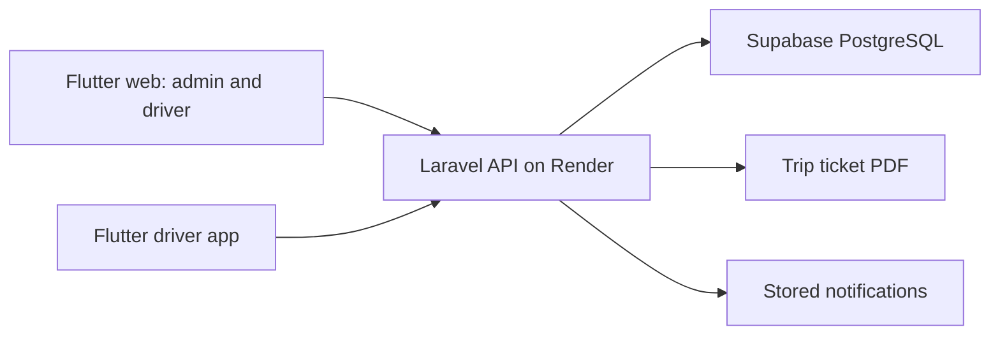

# CPSU Motorpool: system and file guide

Reviewed: 2026-11-13. This documents the local source and the owner's stated hardware workflow. It is not a deployment verification or a claim that every feature passes runtime tests.

## Scope

Reviewed the application entry points, page logic and API calls, service files, backend controllers/models, route definitions, database structure, and selected configuration, deployment, UI support, and test files across the three repositories. Large Flutter pages were inspected through their state, loading, action, validation, navigation, and rendering sections; this is not a line-by-line audit of every layout statement. Generated builds, dependency internals, binary assets, private environment values, and platform boilerplate are outside this review.

## Owner-confirmed system

- Admin/gateway location: CPSU Kabankalan.
- Example journey: CPSU San Carlos to CPSU Kabankalan.
- Drivers request trips through either the web driver interface or the dedicated driver application. Admin approves; the assigned driver clicks Start Trip.
- Backend hosting: Render. Database hosting: Supabase, as confirmed by the owner. The local Laravel database configuration selects PostgreSQL.
- Admin hardware: Raspberry Pi 4 and Heltec LoRa V2.
- Vehicle hardware: Heltec LoRa V2, GPS module, SIM module, microSD module, buck converter, and 7.4 V 12,000 mAh battery.
- The reference image proposes cellular upload first, LoRa backup, and microSD storage. Its 11.1 V battery specification does not describe the owner's actual battery.
- Intended tracking: start recording when the driver starts the approved trip; upload through cellular internet; preserve unsent GPS records on microSD; retry when internet returns; transfer remaining records over LoRa when the vehicle reaches the admin gateway's coverage.
- LoRa reception at the Pi can work without cloud connectivity. Cloud forwarding and viewing locally while the Pi is offline are separate functions still needing implementation.

## Existing software flow

Both clients use the configured API base `https://cpsu-motorpool-backend.onrender.com/api`. They use HTTP requests and polling, not an implemented GPS streaming connection.

1. Login issues a Sanctum token with the user's role and name.
2. A campus assignment links a driver and vehicle. Driver request forms obtain the vehicle through `/my-assignment`.
3. Driver submission creates a pending trip, passengers, two movement records, and notifications for admins.
4. Admin approval sets stored status to `approved`; the model exposes `effective_status=scheduled`.
5. The assigned driver calls `/trips/{id}/start`. The backend requires the scheduled calendar day and allows starting from 10 minutes before departure onward that day.
6. Outbound completion changes movement 1 to completed; the overall trip remains active.
7. Return start activates movement 2. Return completion sets the whole trip to completed.
8. Admin-created trips use explicit driver/vehicle selection, `source=admin`, and approved status immediately.

## Admin repository: `D:/cpsumotorpooladmin`

Paths below are relative to this repository.

| File | Responsibility / observation |
|---|---|
| `lib/main.dart` | Routes, admin/driver role guards, theme, notification host, five-minute inactivity logout. |
| `lib/pages/splash_screen.dart` | Animated splash; `_checkAuthStatus()` is still a placeholder returning null. |
| `lib/pages/feautures/auth/Login.dart` | Login form; routes admin to `/` and driver to `/driver-dashboard`. |
| `lib/pages/feautures/auth/ForgotPassword.dart` | Driver password-reset request UI. |
| `lib/pages/services/auth_service.dart` | Auth service used by the current routes and API services; secure token, role, and name storage. |
| `lib/services/auth_service.dart` | Separate older-looking SharedPreferences implementation expecting a nested `user` response. No importing source file was found in `lib`; do not confuse it with the active service. |
| `lib/pages/Admin/pages/Dashboard.dart` | Loads trip, vehicle, and driver counts; embeds the sample fleet map. |
| `lib/pages/Admin/pages/TripRequest.dart` | Filters pending requests, reviews details/PDF, approves or denies; polls every 15 seconds. |
| `lib/pages/Admin/pages/AdminCreateTripTicket.dart` | Admin-created trip list and form, resource availability, passengers, outbound/return schedules, PDF. Reached from the shell using a page route. |
| `lib/pages/Admin/pages/Activetrip.dart` | Scheduled/active trip list, PDF, navigation to map; polls every 15 seconds. |
| `lib/pages/Admin/pages/TripHistory.dart` | Requests completed trips with pagination; details and PDF. Depends on server filtering that the current listing method does not perform. |
| `lib/pages/Admin/pages/VehiclesDrivers.dart` | Paginated driver/vehicle management, forms, deletion, and driver password reset. |
| `lib/pages/Admin/pages/CoordinatorAssignments.dart` | Campus/coordinator/driver/vehicle assignment management; obtains selectable resources from availability endpoints. |
| `lib/pages/Admin/pages/DeviceRegistry.dart` | Register a device ID against a vehicle, list/edit/delete records, display device metadata. |
| `lib/pages/Admin/pages/Map.dart` | Full fleet map and vehicle chips, using the static `activeVehicles` list. |
| `lib/pages/Admin/pages/SnycLogs.dart` | Sync-log presentation using `_mockLogs`; no live synchronization API. Filename is spelled `SnycLogs`. |
| `lib/pages/Admin/pages/Settings.dart` | Admin profile fetch and password change. |
| `lib/pages/Driver/pages/Dashboard.dart` | Driver counts, notifications, selected active/scheduled trip, all four movement actions, navigation, logout. |
| `lib/pages/Driver/pages/CreateTripTicket.dart` | Multi-step request, assigned vehicle, passengers, outbound/return schedule. |
| `lib/pages/Driver/pages/MyTrips.dart` | Non-completed trips, status badges, details and PDF; polls every 15 seconds. |
| `lib/pages/Driver/pages/ScheduleTrip.dart` | Scheduled trips and Start Trip; this page's button waits until the exact departure time. |
| `lib/pages/Driver/pages/History.dart` | Completed trips, movement details and PDF downloads. |
| `lib/pages/Driver/pages/Settings.dart` | Driver profile/role check and password change. |
| `lib/pages/Driver/pages/ActiveTrip.dart` | Comment-only placeholder. Current movement actions live in the dashboard. |
| `lib/services/trip_service.dart` | Trip API requests, approve/deny, movement actions, availability, creation, PDF response handling. Movement calls currently send no GPS coordinates. |
| `lib/services/assignment_service.dart` | Current driver's assignment lookup. |
| `lib/services/coordinator_assignment_service.dart` | Assignment CRUD requests. |
| `lib/services/device_service.dart` | Registry CRUD and vehicle/device lookups; no GPS ingestion. |
| `lib/services/driver_service.dart` | Driver CRUD, paging/search and admin password reset requests. |
| `lib/services/vehicle_service.dart` | Vehicle CRUD and paging/search requests. |
| `lib/services/notification_service.dart` | Stored notifications, unread count and mark-as-read. |
| `lib/services/pdf_opener.dart` | Conditional platform selection for PDF operations. |
| `lib/services/pdf_opener_web.dart` | Browser tabs, Blob URLs and PDF downloads. |
| `lib/services/pdf_opener_stub.dart` | Temporary PDF files and native opening, with Windows fallbacks. |
| `lib/services/pdf_window_handle.dart` | Interface shared by the platform PDF implementations. |
| `lib/data/active_vehicles.dart` | Three hardcoded sample vehicles near Bacolod and a default map center. |
| `lib/widgets/active_vehicles_map.dart` | OpenStreetMap tiles, sample vehicle markers and zoom controls. |
| `lib/widgets/app_shell.dart` | Shared styles/layout, sidebar, navigation, notification controller, polling and trip badges. |
| `lib/widgets/admin_page_wrapper.dart` | Alternative persistent-sidebar wrapper; no importing source file found in `lib`. |
| `lib/widgets/app_notification.dart` | Transient success/error banners. Separate from database notifications. |
| `lib/widgets/interaction_loading_overlay.dart` | Blocking loading overlay and shared show/hide support. |
| `lib/widgets/skeleton_widgets_web.dart` | Loading skeletons for cards, lists and tables. |
| `lib/generate_icon.dart` | Utility to generate a rounded app icon; not trip logic. |
| `pubspec.yaml` | Flutter dependencies, assets, fonts and icon-generation settings. |
| `web/index.html` | Browser bootstrap/loading presentation. |
| `vercel.json` | Web build/output settings and single-page route rewrites. |
| `test/widget_test.dart` | Default counter smoke test; does not reflect this application's current UI. |
| `DEVICE_REGISTRY_IMPLEMENTATION_GUIDE.md` | Historical implementation instructions; its claim that backend registry files are absent is stale. |

## Driver repository: `D:/cpsumotorpooldriverapp`

| File | Responsibility / observation |
|---|---|
| `lib/main.dart` | Theme, route table and notification host. Starts on splash; `/profile` remains a placeholder. |
| `lib/pages/splash_screen.dart` | Two-second animated splash then login. |
| `lib/pages/loginpage.dart` | Login form and driver-role check before opening dashboard. |
| `lib/pages/forgot_password_page.dart` | Reset-email request and response feedback. |
| `lib/pages/dashboard.dart` | Trip counts, selected trip, notifications, outbound/return actions, logout; 30-second refresh. |
| `lib/pages/create_trip_ticket.dart` | Assigned-vehicle request form, passengers and departure/return times. |
| `lib/pages/Mytrip.dart` | Non-completed trips, details/PDF, associated notification read status; 15-second polling. |
| `lib/pages/ScheduledTrip.dart` | Scheduled-trip list, PDF, Start Trip; permits the same 10-minute early window as the backend. |
| `lib/pages/History.dart` | Completed-trip retrieval, search, movement details and PDF. Pagination currently defaults to one page. |
| `lib/pages/Notifications.dart` | Fetches database notifications and marks individual entries read. |
| `lib/pages/settings.dart` | Profile display and password change. |
| `lib/services/auth_service.dart` | Login, secure storage, profile, password change/reset, local logout. |
| `lib/services/trip_service.dart` | Assignment, trip creation/listing, four movement endpoints and PDF validation. No hardware command or coordinates sent. |
| `lib/services/notification_service.dart` | Notification list/count/read operations and marking notifications for a trip. |
| `lib/theme/app_theme.dart` | Shared colors, typography, cards and visual background. |
| `lib/widgets/app_notification.dart` | Transient UI banners. |
| `lib/widgets/interaction_loading_overlay.dart` | Blocks interaction while an operation runs. |
| `lib/widgets/skeleton_widgets.dart` | Loading placeholders. |
| `pubspec.yaml` | Flutter packages, assets and fonts. |
| `android/app/src/main/AndroidManifest.xml` | Android entry activity and internet permission. |
| `web/index.html` | Web entry/loading presentation. |
| `test/dashboard_test.dart` | Dashboard button visibility test; not hardware integration coverage. |
| `DRIVER_APP_BUG_FIXES.md` | Historical fix guide; inspect current source before applying its instructions. |

## Backend repository: `D:/cpsumotorpoolbackend`

| File / directory | Responsibility / observation |
|---|---|
| `routes/api.php` | Login/reset, admin CRUD, trip lifecycle, notifications, devices and diagnostic routes. |
| `routes/web.php` | Welcome page and browser password-reset form/submission. |
| `routes/console.php` | Console command definitions. |
| `bootstrap/app.php` | Routing and registration of the `role` middleware alias. |
| `app/Http/Middleware/EnsureUserHasRole.php` | Checks authenticated user's role. |
| `app/Http/Controllers/AuthController.php` | Password verification, Sanctum token issuance and password change. |
| `app/Http/Controllers/DriverController.php` | Driver search/pagination, CRUD, temporary-password reset. |
| `app/Http/Controllers/VehicleController.php` | Vehicle search/pagination, CRUD and status. |
| `app/Http/Controllers/CoordinatorAssignmentController.php` | Campus assignment CRUD. |
| `app/Http/Controllers/MyAssignmentController.php` | Current user's assignment with vehicle; 404 if absent. |
| `app/Http/Controllers/TripController.php` | Requests/admin assignments, resource conflicts, movements, approve/deny, access checks and PDFs. |
| `app/Http/Controllers/DeviceController.php` | Registry CRUD, vehicle lookup and public health check. No telemetry/heartbeat receiver. |
| `app/Http/Controllers/NotificationController.php` | User-scoped notifications and read/count operations. |
| `app/Http/Controllers/PasswordResetController.php` | Driver-only email reset flow, optional whitelist, token reset and session-token revocation. |
| `app/Models/User.php` | Account fields, password hashing, Sanctum tokens, reset notification. |
| `app/Models/Vehicle.php` | Vehicle name, plate and status. |
| `app/Models/CoordinatorAssignment.php` | Campus/coordinator plus driver and vehicle relationships. |
| `app/Models/Trip.php` | Trip fields, effective status, driver/vehicle/passenger/movement relationships. |
| `app/Models/TripMovement.php` | Outbound/return schedule, actual timestamps, optional departure/arrival coordinates and status. |
| `app/Models/TripPassenger.php` | Passenger name/designation linked to trip. |
| `app/Models/Notification.php` | Recipient, trip, message and read flag. |
| `app/Models/Device.php` | Device-to-vehicle mapping, last-seen and online fields. |
| `app/Providers/AppServiceProvider.php` | HTTPS generation, rate limits and cache invalidation observers. |
| `app/Support/TripListingCache.php` | Cache version key and invalidation helper. |
| `app/Observers/TripListingCacheObserver.php` | Invalidates cache version when related models change. Current trip index does not read a listing cache. |
| `app/Helpers/InputSanitizer.php` | String/email cleaning used by driver/vehicle management. |
| `app/Rules/StrongPassword.php` | Password complexity validation. |
| `app/Notifications/ResetPasswordNotification.php` | Password-reset email URL and view. |
| `resources/views/trip_ticket.blade.php` | Printable trip ticket: vehicle, driver, route, passengers and two movement rows. |
| `resources/views/auth/reset-password.blade.php` | Browser reset form. |
| `resources/views/emails/password-reset.blade.php` | Reset email presentation. |
| `database/migrations` | Users/tokens, vehicles, assignments, trips, passengers, notifications, movements, return schedule, source and registry schema. |
| `database/seeders`, `database/factories` | Account seeding and test data construction; not executed during review. |
| `config/app.php` | Application timezone is `Asia/Manila`. |
| `config/database.php` | Hardcoded default connection is `pgsql`; supports PostgreSQL configuration for the stated Supabase database. |
| `config/auth.php` | Authentication and optional password-reset testing whitelist. |
| `config/cors.php` | Browser API origin policy, including Vercel and localhost. |
| `composer.json` | Laravel 12, Sanctum, Dompdf, Resend and PHP requirements. |
| `Dockerfile` | Nginx/PHP container setup, production environment and startup. |
| `scripts/00-laravel-deploy.sh` | Installs production dependencies, caches config/routes and runs migrations. |
| `scripts/01-storage-link.sh` | PDF storage directory permissions and public storage link. |
| `phpunit.xml`, `tests/TestCase.php` | Test configuration/base class; see isolation note below. |
| `tests/Feature/TripStatusFlowTest.php` | Intended approval/start window, ownership, availability and PDF behaviors. |
| `tests/Feature/NotificationSystemTest.php` | Intended trip notification and password-change behaviors. |
| `tests/Feature/PasswordResetTest.php` | Intended reset flow, role restrictions, whitelist and throttling behaviors. |
| `tests/Feature/TripIndexCacheTest.php` | Expects filtered/paginated responses with `data`; differs from current trip index response. |
| `mysql databse/cpsu_motorpool.sql` | Older MySQL export/schema reference, not evidence of current Supabase contents. Only schema statements inspected. |
| `test_render.php` | Utility that creates an admin token and prints it. Read only; not executed. |

## Concrete observations to retain

These are static-code findings, not fixes performed during this review.

1. **Tracking is not integrated yet.** There is no GPS sample table, telemetry ingest endpoint, device command endpoint, or gateway synchronization implementation in the inspected application source. Movement coordinates are optional endpoint fields, not a continuous location history. Neither client supplies them in movement calls.
2. **Registry is implemented in source.** The registry's `last_seen`/`is_online` fields exist, but no heartbeat ingestion updates them. Registry presence alone does not make hardware online.
3. **Map and sync logs are samples.** `active_vehicles.dart` and `_mockLogs` supply their data. The map defaults to Bacolod, while the owner's gateway is in Kabankalan.
4. **Web/mobile start behavior differs.** Web scheduled page waits until exact departure; mobile scheduled page/backend allow 10 minutes early. Both dashboards also offer movement actions, with the backend enforcing start eligibility.
5. **Admin trip listing ignores requested filters/paging.** `TripController::index()` returns all trips as a plain list. Admin history requests `status=completed` but does not independently filter the received list, so the current source can show other statuses there.
6. **Dashboard totals need care.** Admin driver/vehicle totals use the returned page length instead of paginator `total`. The mobile dashboard breaks its counting loop when it finds an active trip, potentially omitting later records from counts.
7. **Existing tests and source are not fully aligned.** Cache tests expect pagination/filtering absent from current index; reset tests expect three attempts/hour while the provider currently sets 50. The admin widget test is still the starter counter test.
8. **Database tests must be isolated before execution.** `phpunit.xml` requests SQLite memory storage, but `config/database.php` hardcodes PostgreSQL and the base test class has no override. Tests using `RefreshDatabase` should not be run assuming that the XML alone isolates them from the configured database.
9. **Historical docs are not deployment truth.** The registry guide says backend files are missing and discusses manual migrations, while source contains registry files and a deployment script that invokes migrations. Live Render/Supabase state was not queried.
10. **Two driver implementations must be maintained together.** Changes to trip rules should be traced through web driver pages, mobile pages, both trip services, and the backend controller/model.

## Hardware integration boundaries still to define

- How the vehicle learns that its assigned trip has started, including when the tracker is offline at that moment.
- How a registered device is authenticated and linked to a particular trip and movement.
- GPS record identity and original capture timestamp, so delayed uploads do not replace the latest location with an older sample.
- Acknowledgements, retry rules and duplicate handling for cellular uploads and LoRa-to-Pi transfer.
- Pi durable local storage and cloud forwarding, plus a local viewing path if the admin needs visibility while the Pi is offline.
- Live map/history/sync-log APIs backed by real records.

No Heltec firmware or Raspberry Pi gateway program was found in the searched source of these three repositories. Those may exist in a different folder. Their behavior remains the owner's intended design, not something verified from these apps.

## Review result

The implemented software provides the trip-management workflow and device registry foundation. The requested vehicle GPS, cellular retry, microSD buffering and LoRa gateway workflow still needs a hardware-to-backend integration layer. This review added documentation only; no application behavior, database, deployment, or hardware was changed, and no runtime tests were executed.
